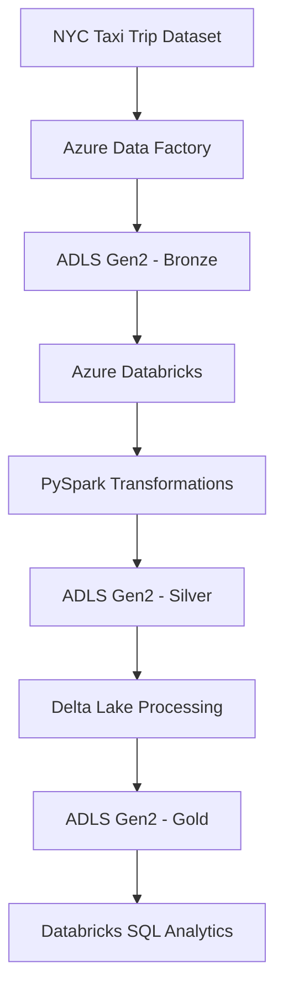

# NYC Taxi Data Engineering Project

## Project Overview

This project implements an Azure-based data engineering workflow using New York City taxi trip records. It focuses on moving source data into cloud storage, processing it with Apache Spark, and organizing the output into structured data layers for analytical use.

The solution combines Azure Data Factory, Azure Data Lake Storage Gen2 and Azure Databricks to demonstrate an end-to-end data processing workflow using the Medallion Architecture.

## Architecture



## Technology Stack

| Technology | Purpose |
|---|---|
| Azure Data Factory | Data ingestion and pipeline orchestration |
| Azure Data Lake Storage Gen2 | Centralized cloud storage |
| Azure Databricks | Distributed data processing |
| PySpark | Data cleansing and transformations |
| Delta Lake | Structured storage and table versioning |
| SQL | Querying and managing curated datasets |
| GitHub | Source code and project version control |

## Data Processing Workflow

### 1. Data Ingestion – Bronze Layer

- Use Azure Data Factory resources to manage the ingestion workflow.
- Store incoming taxi trip records in the Bronze container of ADLS Gen2.
- Maintain source datasets, including trip records and supporting lookup information.

### 2. Data Transformation – Silver Layer

Implemented through the `Silver_notebook.ipynb` notebook using PySpark.

Key operations include:

- Reading Parquet trip records and CSV reference datasets.
- Defining an explicit schema for taxi trip records.
- Renaming columns to improve consistency.
- Splitting taxi zone information into separate attributes.
- Extracting trip date, year and month from pickup timestamps.
- Selecting relevant columns for downstream processing.
- Writing processed datasets in Parquet format to the Silver layer.

### 3. Curated Data – Gold Layer

Implemented through the `gold_notebook.ipynb` notebook.

Key operations include:

- Reading processed datasets from the Silver container.
- Creating a Gold database in Databricks.
- Writing curated datasets as Delta tables.
- Organizing trip records, trip types and taxi zone reference data.
- Executing SQL queries against the created tables.

### 4. Delta Lake Exploration

The Gold notebook also demonstrates practical Delta Lake operations:

- Creating and querying Delta tables.
- Updating and deleting table records.
- Reviewing table transaction history using `DESCRIBE HISTORY`.
- Restoring a previous table version.
- Exploring Delta Lake time-travel capabilities.

## Repository Structure

```text
NYC-Taxi-Project/
│
├── dataset/
│   └── Source datasets
│
├── factory/
│   └── Azure Data Factory configuration
│
├── linkedService/
│   └── Linked service definitions
│
├── pipeline/
│   └── Pipeline definitions
│
├── Silver_notebook.ipynb
│
├── gold_notebook.ipynb
│
├── taxi_zone_lookup.csv
│
├── trip_type.csv
│
├── publish_config.json
│
└── README.md
```

## Getting Started

### Prerequisites

- An active Azure subscription.
- Azure Data Factory.
- Azure Data Lake Storage Gen2 account.
- Azure Databricks workspace with compute access.
- Familiarity with Python, PySpark and SQL.

### Implementation Steps

1. Obtain the NYC taxi trip dataset and supporting reference files.
2. Create an ADLS Gen2 storage account with Bronze, Silver and Gold containers.
3. Configure the required linked services and datasets in Azure Data Factory.
4. Configure the Data Factory pipeline resources for the ingestion workflow.
5. Connect Azure Databricks to ADLS Gen2 with appropriate storage permissions.
6. Update storage paths and configuration values in the notebooks.
7. Execute `Silver_notebook.ipynb` to process the source datasets.
8. Execute `gold_notebook.ipynb` to create the curated Delta tables.
9. Run SQL queries to explore the resulting datasets and Delta Lake features.

**Note:** Azure resources, linked services, permissions and storage paths must be configured in your own environment before execution. The notebooks currently reference the original project storage account and should be updated accordingly.

## Learning Outcomes

This project provided hands-on experience with:

- Integrating Azure Data Factory with cloud storage.
- Working with ADLS Gen2 containers and storage paths.
- Processing structured datasets using PySpark.
- Applying Medallion Architecture principles.
- Creating and managing Delta Lake tables.
- Understanding Delta transaction history and time travel.
- Querying curated datasets using Databricks SQL.

## Data Source

The project uses NYC Taxi and Limousine Commission trip record data.

Official dataset: https://www.nyc.gov/site/tlc/about/tlc-trip-record-data.page

## Project Repository

GitHub: https://github.com/SiddharthV26/NYC-Taxi-Project

---

**Author:** Siddharth Vanakudari

**Focus:** Azure Data Engineering | Databricks | PySpark | Data Lakehouse
